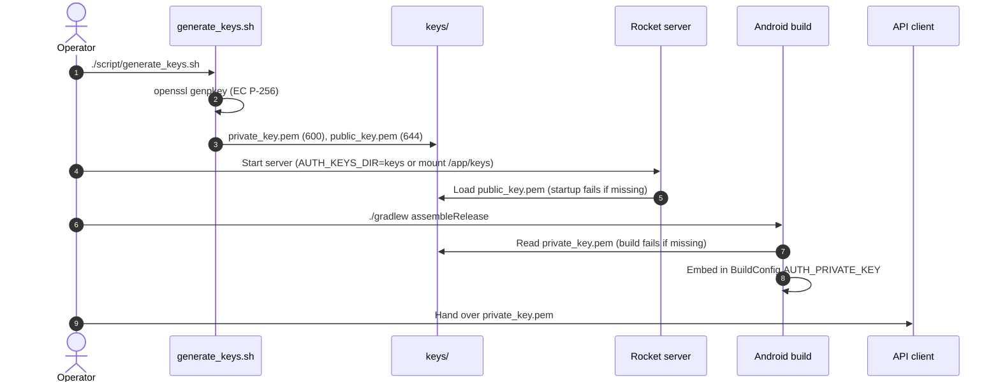
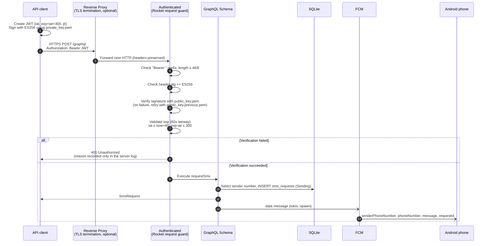
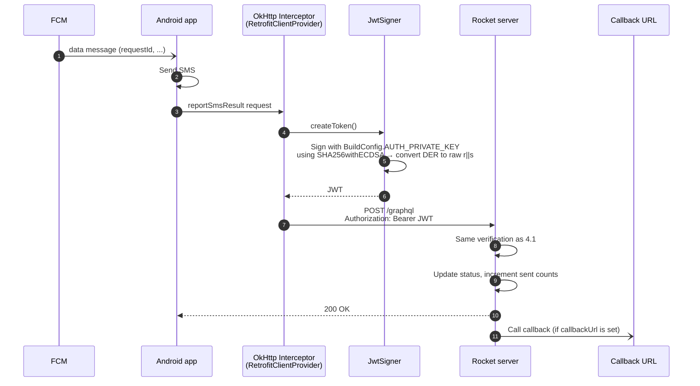
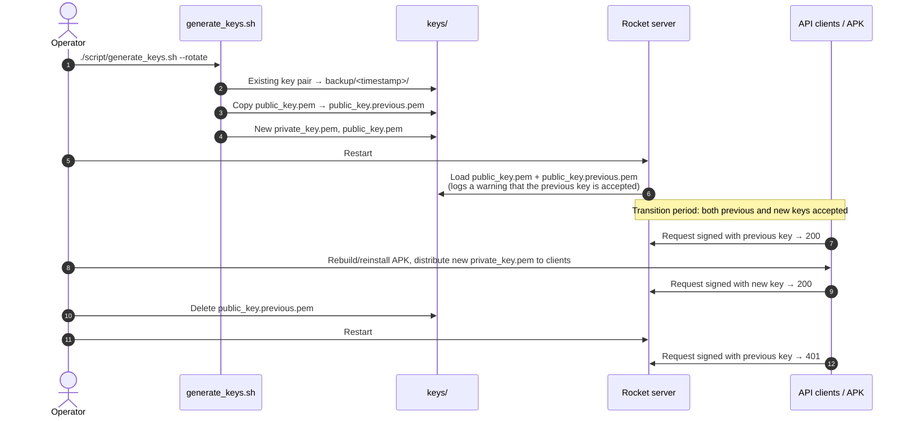

# Shared-Key Signed JWT Authentication

> Applies to: `sms_transmitter_rocket` server, `sms_transmitter_Android` app
> Implementation: `src/auth.rs`, `script/generate_keys.sh`, `script/make_jwt.sh`, Android `JwtSigner.kt`

## 1. Overview

All of the server's GraphQL APIs (`/graphql` GET/POST) are protected by **a single ES256 key pair**.

- **Private key** (`keys/private_key.pem`): shared by all API callers. Used by the backends/scripts that call `requestSms`, and also embedded in the Android APK at build time.
- **Public key** (`keys/public_key.pem`): held only by the server. The server only verifies signatures, so it does not need the private key.

For every request, the caller signs a short-lived JWT with the private key and sends it in the `Authorization: Bearer <JWT>` header. The server verifies the signature with the public key and, if it passes, allows **every API**. There is no distinction by role or resource ownership.

### Why this approach

- This is self-hosted open source: each operator creates their own keys and builds the APK, with no app store distribution. So a single trust boundary, where the operator hands out the key only to callers they trust, is sufficient.
- API calls use no sessions or server-stored tokens. The only server state is the public key file. (The admin web page keeps short-lived in-memory sessions; see 4.3.)
- Since the server holds only the public key, a leaked server configuration or image cannot be used to impersonate a caller.
- Wherever TLS is terminated (nginx, Traefik, Cloudflare, etc.), it works as long as the header is forwarded.

### Assumptions and limitations

- **Whoever holds the private key can call every API.** An APK containing the key has the same privileges, so it must not be distributed publicly.
- Since all callers use the same key, you cannot tell who made a call from the request alone.
- If the key leaks from any one place, the key must be rotated everywhere.
- Transport encryption is outside the scope of this design. If you expose the server externally, **always put it behind HTTPS**.

## 2. Key generation and file layout

```bash
./script/generate_keys.sh            # generate only if no keys exist
./script/generate_keys.sh --rotate   # rotate
KEYS_DIR=/path/to/keys ./script/generate_keys.sh
```

| File | Purpose | Permissions |
|---|---|---|
| `keys/private_key.pem` | PKCS#8 EC P-256 private key. Used by API callers and the Android build | 600 |
| `keys/public_key.pem` | Used by the server for verification (required; the server fails to start without it) | 644 |
| `keys/public_key.previous.pem` | Exists only during rotation. The previous public key continues to be accepted | 644 |
| `keys/backup/<timestamp>/` | Backup of the key pair from before rotation | 600 |

`keys/` and `*.pem` are listed in `.gitignore` and `.dockerignore`, so they are not included in the repository or Docker images.



## 3. JWT format

**Header**

```json
{ "alg": "ES256", "typ": "JWT" }
```

**Claims**

| claim | Required | Description |
|---|---|---|
| `iat` | Yes | Issued-at time (Unix seconds) |
| `exp` | Yes | Expiration time. `exp - iat <= 300` |
| `jti` | Recommended | Random value freshly generated for each request. The server does not currently check it |

**Signature**: ES256 (ECDSA P-256 + SHA-256). Per the JWS specification, the signature is the **raw 64-byte `r || s`** value, not DER, encoded with base64url. `openssl dgst -sign` and Java `Signature("SHA256withECDSA")` output DER, so a conversion is required. `make_jwt.sh` and `JwtSigner.derToRawSignature` handle this conversion.

## 4. Request authentication flow

### 4.1 `requestSms` from an API client



### 4.2 Server calls from the Android app (`registerFcmToken`, `reportSmsResult`, etc.)



Because a new JWT is created and attached to every request, there is no need to manage token expiry or renewal separately.

### 4.3 Admin web login (`/admin`)

Browsers cannot attach a fresh JWT to every page navigation, so the admin page logs in once with the same private key:

1. The operator uploads `private_key.pem` on `/admin/login`.
2. The server signs a test JWT with it and verifies that token exactly as in 4.1 (`JwtVerifier::accepts_private_key`). The key is then discarded, never stored.
3. On success the server starts an in-memory session and sets an `admin_session` cookie (HttpOnly, SameSite=Strict, path `/admin`, no expiry).
4. Open admin pages send a heartbeat every 60 seconds. The session expires after 5 minutes without requests, so it ends shortly after every admin page is closed. Logging out or restarting the server also ends it.

Unlike API calls, the private key itself crosses the network once at login. Serve `/admin` over HTTPS when it is reachable from other machines.

## 5. Key rotation

As long as the key has not leaked, there is no need to rotate it periodically. ES256 keys do not weaken with long use or many signatures. However, rotate immediately in the following situations.

- When a phone with the key-embedded APK installed is lost or decommissioned
- When someone who had access to the key leaves
- When the key or APK may have been exposed in a repository, logs, chat, backups, etc.
- When you see abnormal requests with no known cause



When rotating because of a leak, skip the transition period. Delete `public_key.previous.pem` right away and restart the server to block the previous key immediately.

## 6. Deployment environments

| Environment | Where the server reads the public key |
|---|---|
| Local (`cargo run`) | `keys/` (configurable via `AUTH_KEYS_DIR`) |
| Docker | `/app/keys` volume. `docker/docker-compose.yml` mounts `../keys` read-only |
| Kubernetes | Mount the `auth-public-key` Secret at `/app/keys` (`k8s/README.md`) |

The server needs only the public key. In Kubernetes, upload only the public key as a Secret. In Docker, mounting the entire `keys/` directory also exposes the private key inside the container, so mount just the public key file separately if needed.

## 7. Client implementation examples

**Shell**: `script/make_jwt.sh`

```bash
curl -H "Authorization: Bearer $(./script/make_jwt.sh)" \
     -H 'Content-Type: application/json' \
     -d '{"query":"mutation { requestSms(input: {phoneNumber: \"01012345678\", message: \"hello\"}) { id status } }"}' \
     http://localhost:54323/graphql
```

**Python** (`PyJWT[crypto]`)

```python
import time, uuid, jwt, requests

private_key = open("keys/private_key.pem").read()

def auth_header():
    now = int(time.time())
    token = jwt.encode(
        {"iat": now, "exp": now + 300, "jti": str(uuid.uuid4())},
        private_key,
        algorithm="ES256",
    )
    return {"Authorization": f"Bearer {token}"}

requests.post("http://localhost:54323/graphql", headers=auth_header(), json={"query": "{ phoneNumbers { phoneNumber } }"})
```

**Node.js** (`jose`)

```js
import { SignJWT, importPKCS8 } from "jose";
import { readFileSync } from "node:fs";
import { randomUUID } from "node:crypto";

const key = await importPKCS8(readFileSync("keys/private_key.pem", "utf8"), "ES256");
const token = await new SignJWT({ jti: randomUUID() })
  .setProtectedHeader({ alg: "ES256", typ: "JWT" })
  .setIssuedAt()
  .setExpirationTime("5m")
  .sign(key);
```

**Rust** (`reqwest` + `jsonwebtoken`)

```toml
[dependencies]
anyhow = "1"
jsonwebtoken = "9"
reqwest = { version = "0.12", features = ["json", "rustls-tls"] }
serde = { version = "1", features = ["derive"] }
serde_json = "1"
tokio = { version = "1", features = ["full"] }
uuid = { version = "1", features = ["v4"] }
```

```rust
use jsonwebtoken::{encode, Algorithm, EncodingKey, Header};
use serde::Serialize;
use serde_json::json;
use std::time::{SystemTime, UNIX_EPOCH};

#[derive(Serialize)]
struct Claims {
    iat: u64,
    exp: u64,
    jti: String,
}

fn create_token(key: &EncodingKey) -> anyhow::Result<String> {
    let now = SystemTime::now().duration_since(UNIX_EPOCH)?.as_secs();
    let claims = Claims {
        iat: now,
        exp: now + 300,
        jti: uuid::Uuid::new_v4().to_string(),
    };
    // jsonwebtoken encodes ES256 signatures in the raw r||s form JWS requires.
    Ok(encode(&Header::new(Algorithm::ES256), &claims, key)?)
}

#[tokio::main]
async fn main() -> anyhow::Result<()> {
    // PKCS#8 PEM created by script/generate_keys.sh
    let key = EncodingKey::from_ec_pem(&std::fs::read("keys/private_key.pem")?)?;
    let client = reqwest::Client::new();

    let response: serde_json::Value = client
        .post("http://localhost:54323/graphql")
        .bearer_auth(create_token(&key)?) // sign a new token for every request
        .json(&json!({
            "query": "mutation($input: RequestSmsInput!) { requestSms(input: $input) { id status } }",
            "variables": { "input": { "phoneNumber": "01012345678", "message": "hello" } }
        }))
        .send()
        .await?
        .error_for_status()?
        .json()
        .await?;

    println!("{response}");
    Ok(())
}
```

Create the `EncodingKey` once and reuse it, but sign a fresh token for every request. Tokens live at most 300 seconds, so caching and reusing a token results in 401 errors once it expires.

## 8. Future considerations

- **Replay protection**: With TLS in place, the 5-minute lifetime is judged sufficient, so duplicate `jti` values are not checked. If this becomes necessary, keep each `jti` in an in-memory cache until its `exp` and reject duplicates.
- **Caller identification**: If per-caller auditing or blocking becomes necessary, the design can be extended to split keys per caller and distinguish them by `kid`. Since the server already accepts multiple public keys, this extension would not be costly.
