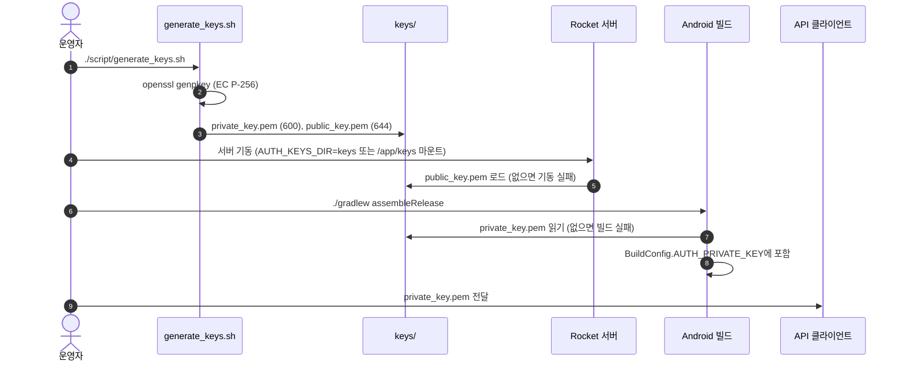
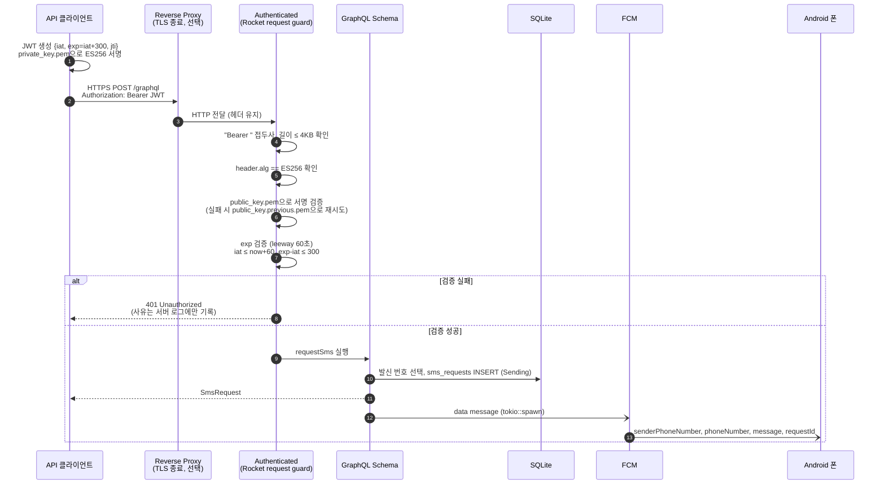
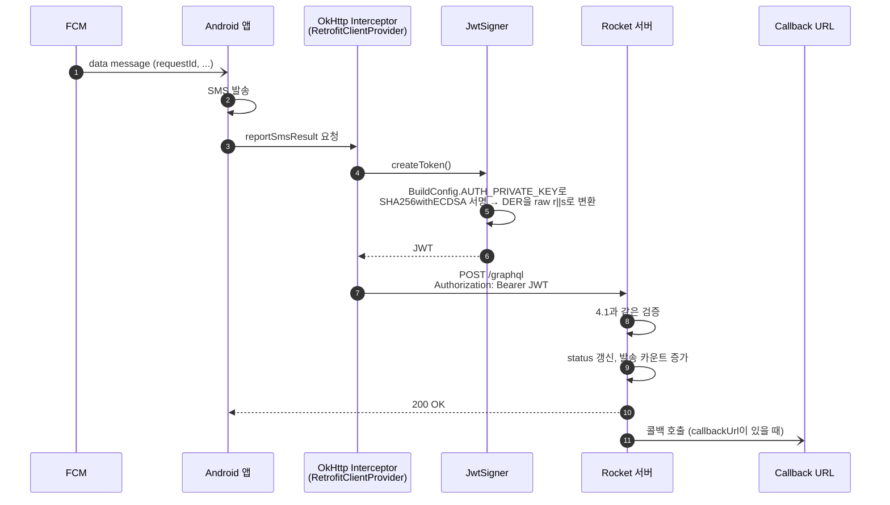
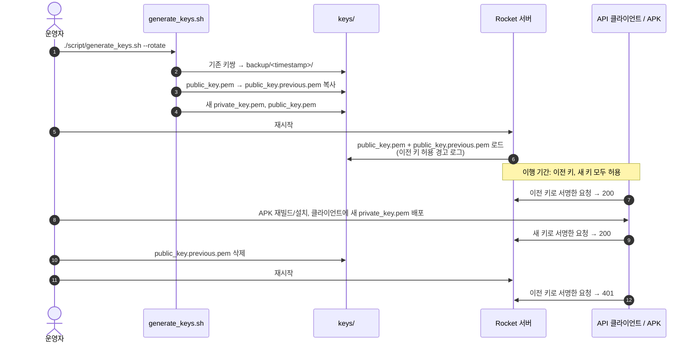

# 공유 키 서명 JWT 인증

> 대상: `sms_transmitter_rocket` 서버, `sms_transmitter_Android` 앱
> 구현: `src/auth.rs`, `script/generate_keys.sh`, `script/make_jwt.sh`, Android `JwtSigner.kt`

## 1. 개요

서버의 모든 GraphQL API(`/graphql` GET/POST)는 **하나의 ES256 키쌍**으로 보호된다.

- **개인키**(`keys/private_key.pem`): API 호출자 전원이 공유한다. `requestSms`를 호출하는 백엔드/스크립트가 사용하고, Android APK에도 빌드할 때 포함된다.
- **공개키**(`keys/public_key.pem`): 서버만 가진다. 서버는 서명 검증만 하므로 개인키가 필요 없다.

호출자는 요청마다 개인키로 수명이 짧은 JWT에 서명해서 `Authorization: Bearer <JWT>` 헤더로 보낸다. 서버는 공개키로 서명을 검증하고, 통과하면 **모든 API**를 허용한다. 역할이나 리소스 소유권 구분은 없다.

### 왜 이 방식인가

- 앱 스토어 배포 없이 각 운영자가 직접 키를 만들고 APK를 빌드하는 셀프호스팅 오픈소스다. 그래서 운영자가 신뢰하는 호출자에게만 키를 나눠 주는 단일 신뢰 경계로 충분하다.
- 세션이나 서버 저장 토큰이 없다. 서버 상태는 공개키 파일뿐이다.
- 서버에는 공개키만 있으므로 서버 설정이나 이미지가 유출돼도 호출자를 사칭할 수 없다.
- TLS를 어디서 종료하든(nginx, Traefik, Cloudflare 등) 헤더만 전달되면 동작한다.

### 전제와 한계

- **개인키를 가진 쪽은 모든 API를 호출할 수 있다.** 키가 포함된 APK도 같은 권한을 가지므로 공개 배포하면 안 된다.
- 모든 호출자가 같은 키를 쓰므로 요청만 보고는 누가 호출했는지 구분할 수 없다.
- 한 곳에서 키가 유출되면 전체 키를 교체해야 한다.
- 통신 암호화는 이 설계의 범위가 아니다. 서버를 외부에 노출한다면 **반드시 HTTPS 뒤에** 둔다.

## 2. 키 생성과 파일 구성

```bash
./script/generate_keys.sh            # 키가 없을 때만 생성
./script/generate_keys.sh --rotate   # 교체
KEYS_DIR=/path/to/keys ./script/generate_keys.sh
```

| 파일 | 용도 | 권한 |
|---|---|---|
| `keys/private_key.pem` | PKCS#8 EC P-256 개인키. API 호출자와 Android 빌드에서 사용 | 600 |
| `keys/public_key.pem` | 서버가 검증에 사용 (필수, 없으면 서버 기동 실패) | 644 |
| `keys/public_key.previous.pem` | 교체 중에만 존재. 이전 공개키도 계속 허용 | 644 |
| `keys/backup/<timestamp>/` | 교체 전 키쌍 백업 | 600 |

`keys/`와 `*.pem`은 `.gitignore`, `.dockerignore`에 등록돼 저장소와 Docker 이미지에 포함되지 않는다.



## 3. JWT 형식

**Header**

```json
{ "alg": "ES256", "typ": "JWT" }
```

**Claims**

| claim | 필수 | 설명 |
|---|---|---|
| `iat` | O | 발급 시각 (Unix 초) |
| `exp` | O | 만료 시각. `exp - iat <= 300` |
| `jti` | 권장 | 요청마다 새로 생성한 랜덤 값. 서버는 현재 검사하지 않음 |

**서명**: ES256(ECDSA P-256 + SHA-256). JWS 규격에 따라 서명은 DER이 아닌 **raw `r || s` 64바이트**를 base64url로 인코딩한다. `openssl dgst -sign`이나 Java `Signature("SHA256withECDSA")`는 DER을 출력하므로 변환이 필요하다. `make_jwt.sh`와 `JwtSigner.derToRawSignature`가 이 변환을 처리한다.

## 4. 요청 인증 흐름

### 4.1 API 클라이언트의 `requestSms`



### 4.2 Android 앱의 서버 호출 (`registerFcmToken`, `reportSmsResult` 등)



모든 요청에 새 JWT를 만들어 붙이므로 토큰 만료나 갱신을 따로 관리할 필요가 없다.

## 5. 키 교체

키가 유출되지 않는다면 주기적으로 교체할 필요는 없다. ES256 키는 오래 쓰거나 많이 서명해도 약해지지 않는다. 대신 다음 상황에서는 즉시 교체한다.

- 키가 포함된 APK가 설치된 폰을 분실하거나 폐기했을 때
- 키에 접근할 수 있던 사람이 떠났을 때
- 키나 APK가 저장소, 로그, 채팅, 백업 등에 노출됐을 가능성이 있을 때
- 원인을 알 수 없는 비정상 요청이 보일 때



유출 때문에 교체하는 경우에는 이행 기간을 두지 않는다. `public_key.previous.pem`을 바로 삭제한 뒤 서버를 재시작해, 이전 키를 즉시 차단한다.

## 6. 배포 환경

| 환경 | 서버가 공개키를 읽는 위치 |
|---|---|
| 로컬 (`cargo run`) | `keys/` (`AUTH_KEYS_DIR`로 변경 가능) |
| Docker | `/app/keys` volume. `docker/docker-compose.yml`이 `../keys`를 읽기 전용으로 마운트 |
| Kubernetes | `auth-public-key` Secret을 `/app/keys`에 마운트 (`k8s/README.md`) |

서버에는 공개키만 있으면 된다. Kubernetes에서는 공개키만 Secret으로 올린다. Docker에서 `keys/` 전체를 마운트하면 개인키도 컨테이너에서 보이므로, 필요하면 공개키 파일만 따로 마운트한다.

## 7. 클라이언트 구현 예시

**Shell**: `script/make_jwt.sh`

```bash
curl -H "Authorization: Bearer $(./script/make_jwt.sh)" \
     -H 'Content-Type: application/json' \
     -d '{"query":"mutation { requestSms(input: {phoneNumber: \"01012345678\", message: \"hello\"}) { id status } }"}' \
     http://localhost:54323/graphql
```

**Python** (`PyJWT[crypto]`)

```python
import time, uuid, jwt, requests

private_key = open("keys/private_key.pem").read()

def auth_header():
    now = int(time.time())
    token = jwt.encode(
        {"iat": now, "exp": now + 300, "jti": str(uuid.uuid4())},
        private_key,
        algorithm="ES256",
    )
    return {"Authorization": f"Bearer {token}"}

requests.post("http://localhost:54323/graphql", headers=auth_header(), json={"query": "{ phoneNumbers { phoneNumber } }"})
```

**Node.js** (`jose`)

```js
import { SignJWT, importPKCS8 } from "jose";
import { readFileSync } from "node:fs";
import { randomUUID } from "node:crypto";

const key = await importPKCS8(readFileSync("keys/private_key.pem", "utf8"), "ES256");
const token = await new SignJWT({ jti: randomUUID() })
  .setProtectedHeader({ alg: "ES256", typ: "JWT" })
  .setIssuedAt()
  .setExpirationTime("5m")
  .sign(key);
```

**Rust** (`reqwest` + `jsonwebtoken`)

```toml
[dependencies]
anyhow = "1"
jsonwebtoken = "9"
reqwest = { version = "0.12", features = ["json", "rustls-tls"] }
serde = { version = "1", features = ["derive"] }
serde_json = "1"
tokio = { version = "1", features = ["full"] }
uuid = { version = "1", features = ["v4"] }
```

```rust
use jsonwebtoken::{encode, Algorithm, EncodingKey, Header};
use serde::Serialize;
use serde_json::json;
use std::time::{SystemTime, UNIX_EPOCH};

#[derive(Serialize)]
struct Claims {
    iat: u64,
    exp: u64,
    jti: String,
}

fn create_token(key: &EncodingKey) -> anyhow::Result<String> {
    let now = SystemTime::now().duration_since(UNIX_EPOCH)?.as_secs();
    let claims = Claims {
        iat: now,
        exp: now + 300,
        jti: uuid::Uuid::new_v4().to_string(),
    };
    // jsonwebtoken encodes ES256 signatures in the raw r||s form JWS requires.
    Ok(encode(&Header::new(Algorithm::ES256), &claims, key)?)
}

#[tokio::main]
async fn main() -> anyhow::Result<()> {
    // PKCS#8 PEM created by script/generate_keys.sh
    let key = EncodingKey::from_ec_pem(&std::fs::read("keys/private_key.pem")?)?;
    let client = reqwest::Client::new();

    let response: serde_json::Value = client
        .post("http://localhost:54323/graphql")
        .bearer_auth(create_token(&key)?) // sign a new token for every request
        .json(&json!({
            "query": "mutation($input: RequestSmsInput!) { requestSms(input: $input) { id status } }",
            "variables": { "input": { "phoneNumber": "01012345678", "message": "hello" } }
        }))
        .send()
        .await?
        .error_for_status()?
        .json()
        .await?;

    println!("{response}");
    Ok(())
}
```

`EncodingKey`는 한 번만 만들어 재사용하고, 토큰은 요청마다 새로 서명한다. 토큰 수명이 최대 300초라서, 토큰을 캐시해 재사용하면 만료 후 401이 된다.

## 8. 향후 고려사항

- **재전송 방지**: TLS 환경에서는 5분 수명으로 충분하다고 판단해 `jti` 중복 검사를 하지 않는다. 필요해지면 메모리 캐시에 `jti`를 `exp`까지 보관해 중복을 거부한다.
- **호출자 구분**: 호출자별 감사나 차단이 필요해지면 키를 호출자별로 나누고 `kid`로 구분하는 구조로 확장할 수 있다. 서버가 이미 공개키 여러 개를 허용하므로 확장 비용이 크지 않다.
